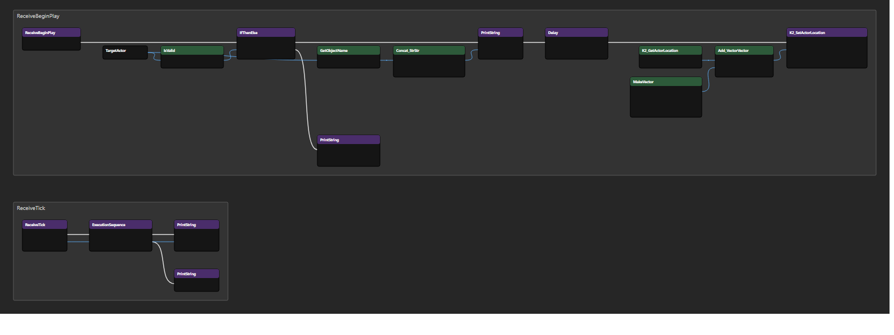

# ue-node-layout

A [Claude Code](https://claude.com/claude-code) skill that auto-arranges Unreal Engine node graphs (Blueprint, Material, …) so they are readable.

When you ask an AI to build Blueprint nodes through a UE MCP server, the nodes almost always end up in one long line. This skill lays them out the way a person would:

- Exec flow runs left → right on one row
- Extra exec outputs (Else, Completed, Then 1, …) branch onto their own rows below, with no overlap
- Pure/data nodes sit to the left of and below the node that uses them, in pin order
- Each event chain is stacked vertically, optionally wrapped in a comment box
- Graphs without exec pins (Materials) become a right-to-left tree from the output node
- Everything snaps to the 16px grid

| Before (MCP output) | After |
|---|---|
| all nodes at `y=0`, `x += 300` |  |

## Install

```bash
git clone https://github.com/wjsekrud/ue-node-layout ~/.claude/skills/ue-node-layout
```

Requires Python 3 (standard library only). Then, in Claude Code, say something like "블루프린트 노드 정리해줘" / "tidy up this Blueprint graph", or run `/ue-node-layout`.

## Three ways to apply a layout

1. **MCP read + move**: if your UE MCP server can list nodes (ids, pins, links) and move them.
2. **Plan before creating**: if the MCP creates nodes with a position argument, positions are computed *before* the nodes are made.
3. **Clipboard (no MCP needed)**: in the editor, Ctrl+A → Ctrl+C; the skill rewrites the copied text in the clipboard; then Delete → Ctrl+V. Ctrl+Z undoes it.

See [SKILL.md](SKILL.md) for details and caveats (function Entry/Result nodes, material output node).

## Script usage

```bash
py scripts/ue_layout.py json graph.json -o layout.json [--comments] [--svg preview.svg]
py scripts/ue_layout.py t3d copied.txt -o organized.txt [--comments]
py scripts/ue_layout.py clip [--comments]        # clipboard in-place
```

Options: `--spacing 1.3` (roomier), `--origin X Y` (top-left of the result).

## Tests

`tests/make_fixture.py` generates a "one long line" Blueprint (`tests/bp_inline.t3d`); `tests/material_edges.json` is a material-style graph for JSON mode.

```bash
py scripts/ue_layout.py t3d tests/bp_inline.t3d -o out.t3d --comments --svg out.svg
```

## License

[MIT](LICENSE)
